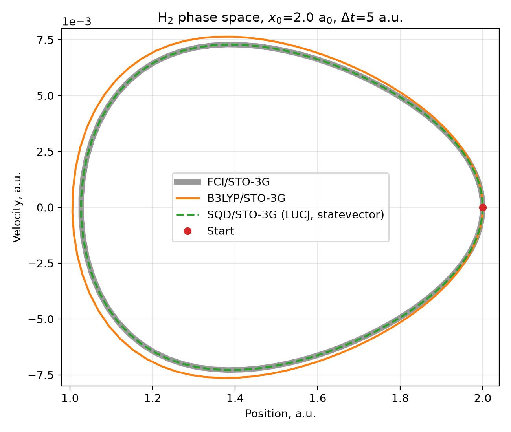

# Ab initio molecular dynamics with sample-based quantum diagonalization

A small, modular Python package (`qmd`) for ab initio molecular dynamics (AIMD) in which
the potential energy can come from any electronic-structure method, including
**sample-based quantum diagonalization (SQD)** on quantum-circuit samples.

The H₂ examples reproduce the bond-vibration dynamics of
D. A. Fedorov, M. J. Otten, S. K. Gray, Y. Alexeev,
*Ab initio molecular dynamics on quantum computers*, J. Chem. Phys. **154**, 164103 (2021)
([doi:10.1063/5.0046930](https://doi.org/10.1063/5.0046930)), with SQD in place of VQE.



## Development

I developed this project as a means of delving into the SQD algorithm and learning how to implement it. Although the use of SQD for ab initio molecular dynamics has already been published (arXiv:2607.28548), I'm developing this code base for future projects and implementations that I'm developing. 
In this project, I specified the physics, steps, and benchmarks/tests for an AI coding agent (Claude Code) and reviewed its code.
Results were accepted only after passing independent checks: an analytic oscillator,
DFT and FCI baselines, and an SQD-versus-FCI comparison at every step.
The code was written with [Claude Code](https://claude.com/claude-code) as an AI pair
programmer.

I also wrote the Jupyter Notebooks (`MolecularDynamics_Tutorial*.ipynb`), without the help of an AI/agent, both as a tutorial
for others, and as a base from which the AI agent can start.

I designed this project as such:

**Implemented**
1. Communicate outline and eventual goal (molecular dynamics using sample-based quantum diagonalization) with agent.
2. Generate library for velocity verlet method.
3. Calculate molecular dynamics for simple harmonic oscillator potential.
4. Use velocity verlet method to calculate molecular dynamics for H<sub>2<\sub> dimer using B3LYP DFT energies in the STO-3G basis. Use parameters from the paper.
6. Use FCI to calculate H<sub>2</sub> dynamics using the same parameters from the paper.
7. Apply SQD from qiskit-sqd-addon. First make sure you can match the FCI ground state energy at a bond length of 1.4 bohr radius.
8. Use velocity verlet with SQD energies to calculate dynamics for H2 in minimal basis. Use statevector simulator.

**To be Implemented**
10. Use my application of Hellmann-Feynman theorem to run a more efficient molecular dynamics simulation. First, use the statevector simulator and make sure that it matches FCI calculations.
11. Increase basis set to cc-pVDZ. Use FCI to calculate the ground state energy at 1.4 bohr radius. Use SQD with a statevector simulator to calculate ground state energy at the same bond length. Make sure that energies match each other.
12. In the cc-pVDZ basis set, at a bond length of 1.4 bohr radius, run SQD with a noisy simulator and apply self-consistent configuration recovery. Make sure that the energy converges to what was calculated from FCI / statevector simulator.
13. Parallelize the self-consistent configuration recovery.
14. Run a molecular dynamics calculation in the cc-pVDZ basis set using self-consistent configuration recovery parameters which converged the energy at 1.4 bohr radius.
15. Use IBM Qiskit Runtime to run the molecular dynamics calculations on a real device. First, run SQD calculation at a bond length of 1.4 bohr radius, then use the converged parameters for the molecular dynamics simulation.

## How it works

The integrator only needs a callable `energy_fn(x) -> float`. Forces come from central
finite differences, `F = -[E(x+d) - E(x-d)] / 2d`, and positions are advanced with
velocity Verlet (`qmd/integrators.py`). The same integrator is driven by:

| Backend | Example | Energy source |
|---|---|---|
| Analytic | `examples/harmonic_oscillator.py` | `V(x) = k x²/2` (integrator test, known period) |
| DFT | `examples/h2_dft.py` | PySCF B3LYP/STO-3G |
| FCI | `examples/h2_fci.py` | PySCF FCI/STO-3G (exact reference) |
| **SQD** | `examples/h2_sqd_md.py` | quantum-circuit samples + subspace diagonalization |

The SQD energy at each geometry (`qmd/sqd.py`) is computed by:

1. **PySCF**: RHF, active-space integrals, and CCSD amplitudes.
2. **ffsim**: a local unitary cluster Jastrow (LUCJ) circuit seeded from the CCSD amplitudes.
3. **Qiskit**: sample bitstrings from the circuit (`StatevectorSampler`, 10⁴ shots).
4. **qiskit-addon-sqd**: project the Hamiltonian onto the sampled determinants and diagonalize.

## Results

* SQD reproduces the FCI trajectory: energies and ground-state vectors match FCI to
  ~10⁻¹⁵ Ha at every MD step (`h2_sqd_states.txt`, `h2_sqd_fci_test.txt`).
* B3LYP gives a slightly wider orbit, as in Fig. 6 of Fedorov et al.

**Scope.** H₂ in STO-3G has only four determinants and the sampler here is noiseless,
so SQD recovers the exact answer by construction. This is a validated end-to-end
pipeline, not a demonstration of quantum advantage.

## Usage

```bash
python -m venv .venv && source .venv/bin/activate
pip install -r requirements.txt

python examples/harmonic_oscillator.py   # integrator sanity check
python examples/h2_dft.py                # DFT trajectory
python examples/h2_fci.py                # FCI reference trajectory
python examples/h2_sqd_fci_test.py       # SQD vs FCI at fixed bond lengths
python examples/h2_sqd_md.py             # SQD-driven MD (overlays FCI if present)
python examples/plot_phase_spaces.py     # comparison figure from saved .npz files
```

All quantities are in atomic units (bohr, hartree, electron masses, a.u. of time).
Outputs (`*.png`, `*_trajectory.npz`, `h2_sqd_states.txt`) are written to the repository root.

## License

MIT; see [LICENSE](LICENSE).
